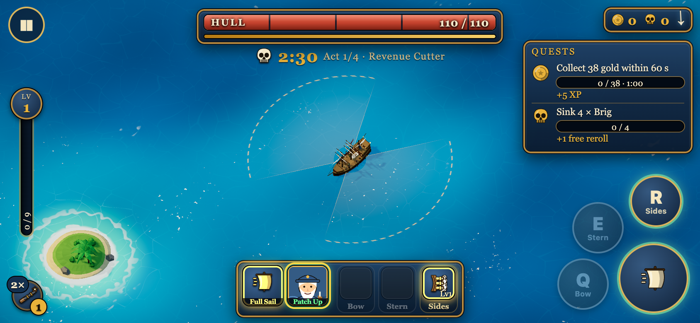
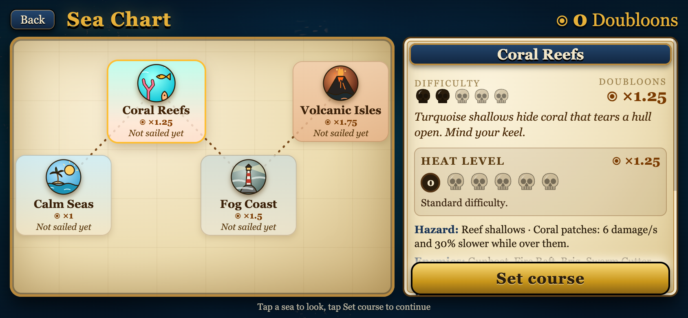

# Broadside

A pirate galleon roguelite that runs in the browser, built with three.js, TypeScript and Vite. You steer a galleon through a sea full of enemy ships, your cannons fire on their own, and every level-up and every boss wreck offers new modules, crew and upgrades. Sink the boss before time runs out, then do it again with a different build.

**Play:** https://scholzdev.github.io/broadside/



## Controls

The game switches between keyboard, gamepad and touch prompts automatically, based on what you used last. It starts muted; press `M` or use the sound button.

### Keyboard and mouse

| Action | Keys |
|---|---|
| Throttle / brake | `W` / `S` or `Up` / `Down` |
| Steer | `A` / `D` or `Left` / `Right` |
| Full Sail (boost) | `Shift` |
| Bow ability | `Q` |
| Stern ability | `E` |
| Sides ability | `R` |
| Pause | `Esc` or `P` |
| Sound on / off | `M` |
| Zoom | Mouse wheel |

Your captain's signature spell casts itself when it fits. Deck modules are passive.

On card screens: `1` / `2` / `3` take a free card, `4` / `5` buy from the shop row, `R` rerolls.

### Gamepad

Left stick steers and sets the throttle. `RT` or `A` boosts. `LB`, `RB` and `Y` fire the bow, stern and sides abilities (the same as `Q`, `E` and `R`). `Start` pauses. Menus use the D-pad, `A` to confirm and `B` to go back.

### Touch

Drag the left stick to steer. The large button on the right is Full Sail; the `Q`, `E` and `R` buttons fire the bow, stern and sides abilities, and the button at the top left pauses. Play in landscape.



## Features

- Four seas, each unlocked by beating the final boss of the previous one
- Heat levels 0 to 5 on every sea for harder runs and bigger rewards
- Endless mode
- 20 captains, each with a passive, a drawback and a self-casting spell
- 3 ships
- 25 modules mounted in bow, stern, sides and deck slots
- Evolutions and synergies between modules
- Crew you can recruit and train
- Relics, quests and a doubloon meta-progression
- Cosmetics for sails, hull, flag, figurehead and wake
- A built-in tutorial
- Procedural music and sound effects
- English and German

## Development

```sh
npm install
npm run dev      # dev server at http://localhost:5173
npm run build    # type-check and production build into dist/
```

URL flags, for testing:

| Flag | Effect |
|---|---|
| `?unlockall` | Everything is unlocked; nothing is saved while it is set |
| `?notut` | Skip the tutorial |
| `?quick` | Start a run immediately with the saved loadout |
| `?fast` | The boss arrives after 20 s instead of 150 s |
| `?lq` / `?hq` | Pin graphics quality to low or high |

Flags combine, for example `?quick&notut`.

## Saves

Progress, unlocks, settings and loadout are stored locally in your browser (`localStorage`). Nothing is sent to a server. Clearing site data, or using the reset button in Settings, deletes your save.
